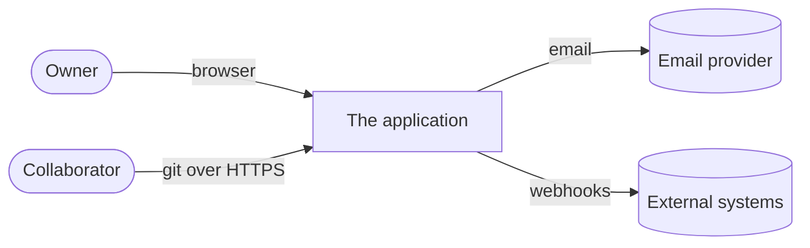
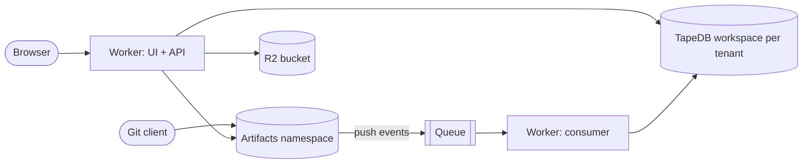
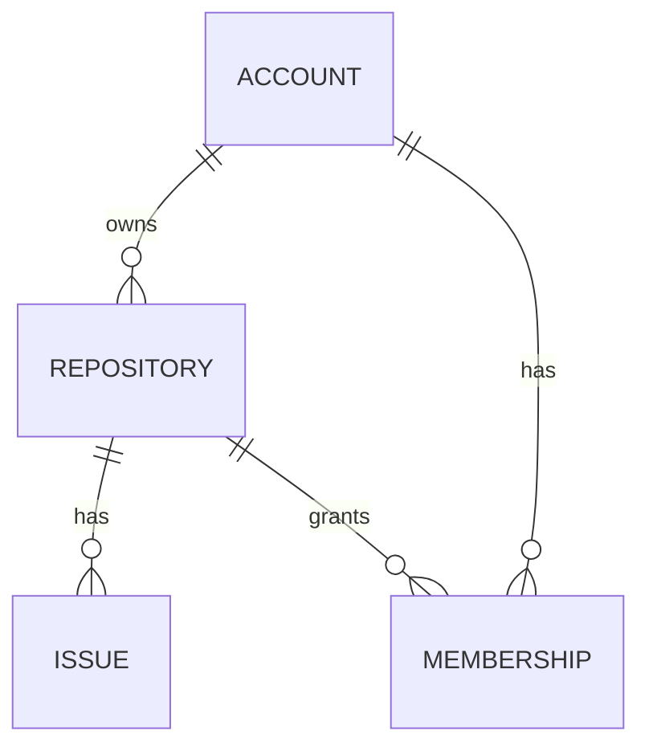
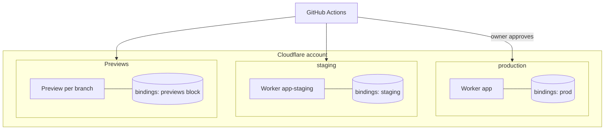
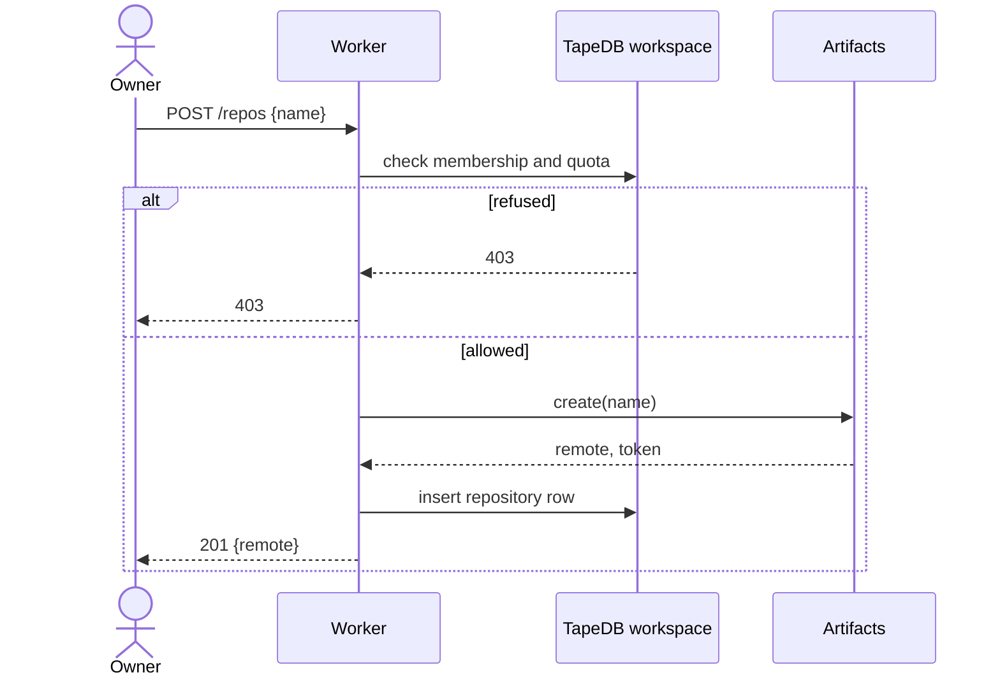
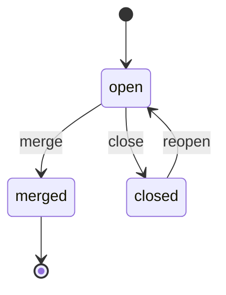

# Diagram starting points

One diagram per file under `docs/serverless/diagrams/`, registered in
`project.json` `diagrams`. Replace the example names; keep every Cloudflare
primitive explicit so the diagram matches the assessment's components.

## context (`diagrams/context.md`)

## container (`diagrams/container.md`)

## data-model (`diagrams/data-model.md`)

## deployment (`diagrams/deployment.md`)

## sequence (`diagrams/uc-1.md`, `covers: ["UC-1"]`)

## state (`diagrams/pull-request-state.md`)

